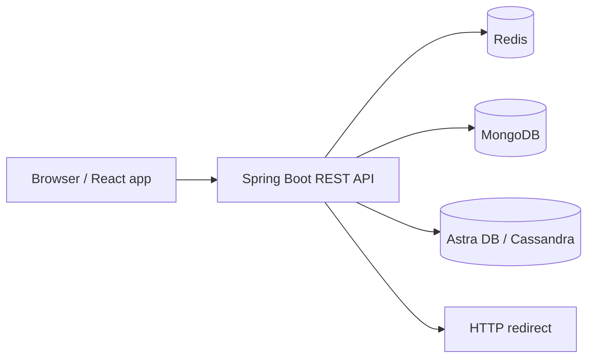

# TinyURL — URL Shortener & Click Analytics API

A full-stack URL shortening project with a **Java 21 / Spring Boot 4** backend and a **React / TypeScript** frontend. It demonstrates a multi-database architecture, short-link redirects, user management, click analytics, automated tests, and containerized deployment.

**Live app:** https://etinyurl.vercel.app/  
**Backend API:** https://url.runmydocker-app.com/  
**API documentation:** https://url.runmydocker-app.com/swagger-ui/index.html  
**Frontend repository:** https://github.com/elad9219/tinyurl-frontend

## What it does

- **Create users** and reject duplicate usernames.
- **Shorten URLs** into six-character alphanumeric codes, with URL normalization and collision checks.
- **Redirect visitors** from a short URL to its original destination.
- **Track link clicks**, including timestamps and per-user and per-link activity.
- **View analytics** through the React interface or REST API.
- **Handle special characters in usernames**, including `/`, with query-based lookup endpoints.
- **Support a sleeping demo backend** through a frontend readiness check and queued user actions.

## Architecture



| Component | Responsibility |
| --- | --- |
| **Redis** | Store and resolve short codes for redirects |
| **MongoDB Atlas** | Store users, link metadata, and aggregated click counters |
| **DataStax Astra DB / Cassandra** | Store timestamped click-history records |
| **Spring Boot API** | Validation, URL creation, redirects, analytics, and REST endpoints |
| **React frontend** | User-facing forms, link creation, and analytics views |

### Technology stack

| Area | Technologies |
| --- | --- |
| Backend | Java 21, Spring Boot 4.1.2, Spring MVC, Maven |
| Persistence | Spring Data Redis, Spring Data MongoDB, Spring Data Cassandra |
| API documentation | springdoc-openapi 3.1.1 / Swagger UI |
| Monitoring | Spring Boot Actuator (`/actuator/health`) |
| Testing | JUnit / Spring Boot Test, Maven |
| Containers | Multi-stage Docker build, Eclipse Temurin 21, non-root runtime user |
| Hosting | RunMyDocker (backend), Vercel (frontend) |
| Frontend | React 19, TypeScript, Axios |

## REST API

The following endpoints are implemented in `AppController`:

| Method | Endpoint | Purpose |
| --- | --- | --- |
| `POST` | `/user?name={username}` | Create a user |
| `GET` | `/user?name={username}` | Get user information and link summaries |
| `POST` | `/tiny` | Generate a short URL for an existing user |
| `GET` | `/{code}/` | Redirect to the original URL and record a click |
| `GET` | `/user/clicks?name={username}` | Retrieve the user's click history |
| `GET` | `/actuator/health` | Check application health |

The older path-based user endpoints are also retained for compatibility. Prefer the query-based endpoints for usernames containing reserved URL characters.

**Example: create a short link**

```http
POST /tiny
Content-Type: application/json

{
  "longUrl": "https://example.com/article",
  "userName": "demo-user"
}
```

A successful request returns a complete short-link URL. The user must already exist.

**Example: health response**

```json
{"groups":["liveness","readiness"],"status":"UP"}
```

Health details are intentionally limited in the deployed configuration.

## Run locally

### Requirements

- JDK **21**
- Maven **3.9+** (or a compatible Maven installation)
- Working connections to Redis, MongoDB, and Cassandra / Astra DB
- A secure-connect bundle for Astra DB when using the cloud Cassandra connection

Clone the repository:

```bash
git clone https://github.com/elad9219/tinyurl.git
cd tinyurl
```

Copy the configuration template:

```bash
cp src/main/resources/application.properties.example \
   src/main/resources/application.properties
```

Fill the local file with **your own** database settings. For local development, place your Astra secure-connect ZIP in `src/main/resources/` and set `astra.db.secure-connect-bundle` to its file name. The application also supports a Base64-encoded secure-connect bundle through `astra.db.secure-connect-bundle-base64` (or its corresponding environment variable).

Run tests and start the server:

```bash
mvn test
mvn spring-boot:run
```

The API listens on `http://localhost:8080` by default. For local short links, configure `base.url=http://localhost:8080/`.

## Docker and deployment

The Dockerfile builds the application with **Maven + Java 21**, then copies only the executable JAR into a smaller **Java 21 runtime image**. The runtime process uses a **non-root user**.

Build the Docker image:

```bash
docker build --platform linux/amd64 -t tinyurl-backend:local .
```

Run it with external configuration (prepare your own environment file **outside the Git repository**, for example at `$HOME/.config/tinyurl/backend.env`, containing the required runtime values):

```bash
docker run --rm --platform linux/amd64 \
  -p 8080:8080 \
  --env-file "$HOME/.config/tinyurl/backend.env" \
  tinyurl-backend:local
```

The container does **not** package local credentials or secure-connect ZIP files. In the deployed version, Spring Boot receives connection settings using `SPRING_APPLICATION_JSON`, including the Base64-encoded Astra secure-connect bundle. Alternative Spring environment variables can also supply the settings.

**Never commit or publish** real `.env` files, `application.properties`, database credentials, or Astra secure-connect bundles. In particular, this repository's existing `.gitignore` does not currently ignore a root `.env` file, so keep the Docker environment file outside the checkout. Use appropriate access restrictions and rotate credentials if they were ever included in a published image.

## Screenshots

*These images are from an earlier UI iteration. They are retained as project references; the live interface may differ slightly.*

### Homepage


### Create User


### Create Tiny URL


### User Information


### Click Details


## Repository structure

```text
src/
├── main/
│   ├── java/com/handson/tinyurl/
│   │   ├── config/
│   │   ├── controller/
│   │   ├── model/
│   │   ├── repository/
│   │   ├── service/
│   │   └── util/
│   └── resources/
└── test/
Dockerfile
pom.xml
```

## Author

**Elad Tennenboim**  
[GitHub](https://github.com/elad9219) · [LinkedIn](https://www.linkedin.com/in/elad-tennenboim/) · [Email](mailto:elad9219@gmail.com)
